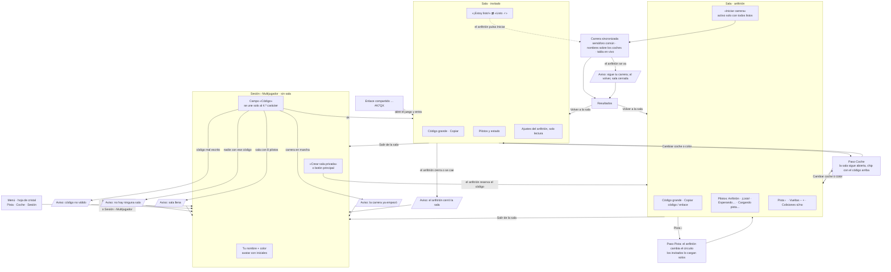

# Multijugador: salas privadas por código (v91)

Sin matchmaking ni buscador público: solo se entra creando una sala o escribiendo su código.

## Flujo de pantallas del menú privado

Mínimo de toques para unirse: **Unirse a sala → escribir el código → ¡Estoy listo!** (con el enlace, ni siquiera el código).

## Módulos

| Archivo | Qué hace |
|---|---|
| `src/net.js` | **Room Manager**: códigos (`normCode`, `codeValid`, `newCode`), los dos transportes (`P2PRoom` con PeerJS y la sala de Claude), admisión (`netRefusal`: sin anfitrión, llena, empezada), unirse/crear/salir, avisos de entradas y salidas, arranque de carrera, envío del estado a 20 Hz, **sincronización del perfil** (`pilotProfile`, `netProfileSync`) e **interpolación** (`netClock`, `netSampleAt`, `netPoseRemote`) y etiquetas con el nombre (`netTags`). |
| `src/lobby.js` | **UI de la sala** dentro de la hoja del menú: formulario de código, sala (código, pilotos, ajustes), botón principal según el estado (`lobbyFoot`, `lobbyPrimary`), chip de sala en la cabecera, avisos emergentes (`netNotify`). |
| `src/main.js` | Llama a lo anterior: modo «Multijugador», colisiones remotas solo si `SES.netCol`, `netTags()` cada cuadro, `netProfileSync()` al cambiar coche o librea. |

### Perfil del piloto (presencia en red)
`pid` (id persistente en `localStorage`), `name`, `car`, librea (`c1` = color del avatar, `c2`, `pt`, `fn`, `rm`), `rdy`, `trk`, `ph`. El id de sesión en red es el id del par (PeerJS o la sala de Claude). Ver la cabecera de `src/net.js` para el registro completo.

### Transportes
- **Dentro de Claude (artefacto):** sala de Claude (`window.claude.use('room')`). Solo admite cuentas con acceso al artefacto (organización o invitados); con enlace público o sin sesión no hay sala, y el botón principal abre la versión web (v104). La admisión la comprueba quien entra, con la presencia que ya ve.
- **Fuera de Claude (hosting propio):** PeerJS (WebRTC). El anfitrión reserva `spa-record-v1-CODIGO` en el servidor público de PeerJS y reenvía el estado de todos (estrella). Decide la admisión y responde `deny` con el motivo.
- **Relé (v106):** si el invitado no consigue canal WebRTC en 4 s (redes móviles, CGNAT, empresas), entra por un broker MQTT público (`armk-racing/v1/CODIGO/h` al anfitrión, `/a` a todos, `/g/<id>` a uno). Mismo protocolo; gana el primer enlace que trae la bienvenida.

### Estados de carrera (v107)
Arreglo corto `[hora, carrera, x, z, rumbo, u, v, vuelta, s, y]` fuera de la presencia. Invitado → anfitrión (`t:'s'`); el anfitrión manda cada 40 ms un paquete `t:'S'` con el último estado de cada piloto. En WebRTC por un segundo canal sin orden. En la sala de Claude siguen en la presencia.

**Indicador en carrera (v107).** Arriba al centro, bajo el nombre de la curva: tipo de enlace (directa / por servidor), ping al anfitrión, FPS y el peor fotograma de los últimos 2 s si pasa de 60 ms. El anfitrión ve cuántos invitados van por cada vía y el peor ping. Sirve para distinguir un problema de red (ping alto, «por servidor») de uno del dispositivo (FPS bajos, tirones).

**Carga del circuito.** Al empezar una carrera todos cargan a la vez y un dispositivo lento puede bloquearse muchos segundos: durante 75 s el silencio tolerado sube de 20 s a 75 s en ambos sentidos.

### Límites conocidos
- Topología en estrella: si el anfitrión se va en mitad de la carrera (PeerJS), los invitados dejan de ver a los demás; su carrera sigue y cuenta. No hay migración de anfitrión.
- Sin servidor autoritativo: cada piloto simula su coche y envía su posición (anti-trampas fuera de alcance).
- PeerJS usa su servidor público de señalización y STUN; donde WebRTC no abre se usa el relé MQTT (brokers públicos gratuitos, sin garantía). Una red que bloquee también WebSocket a 8084/8884 no puede unirse.
- Coches remotos (v106): se dibujan donde están ahora (`netPredict`), no en el pasado; `net_test.mjs lab` lo mide.

## Pruebas
`node tools/net_test.mjs p2p|relay|room|lab` (ver la cabecera del archivo): páginas reales del juego entrando por código, con todos los errores, carrera y salida del anfitrión.
`node tools/net_fresh_test.mjs`: dispositivos nuevos (sin datos guardados) crean salas, también pulsando antes de que cargue PeerJS, y el caso Claude sin acceso a la sala.
